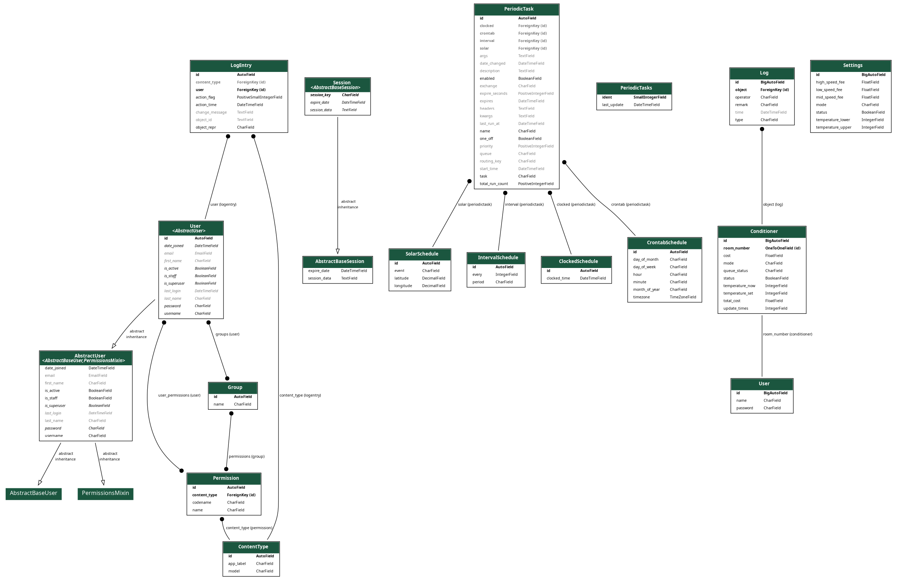
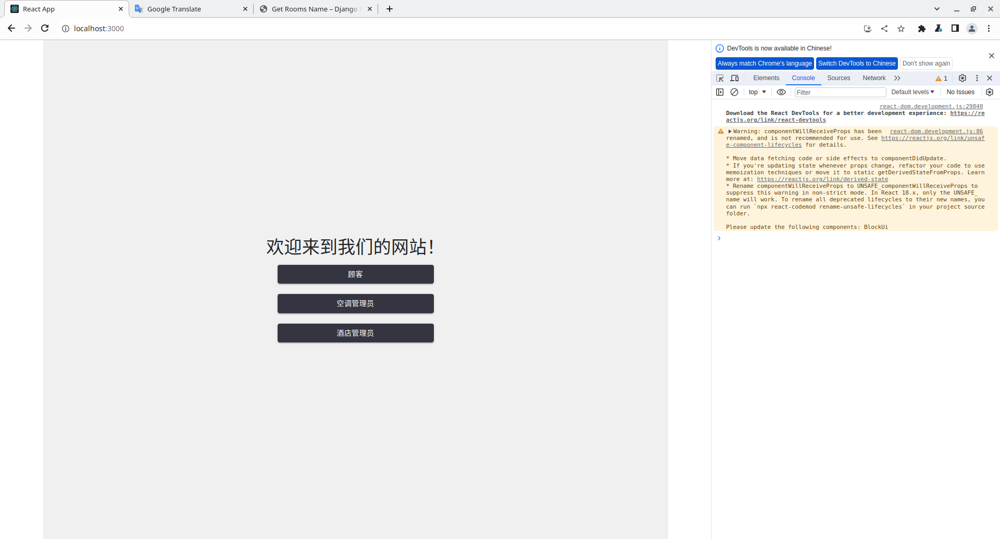
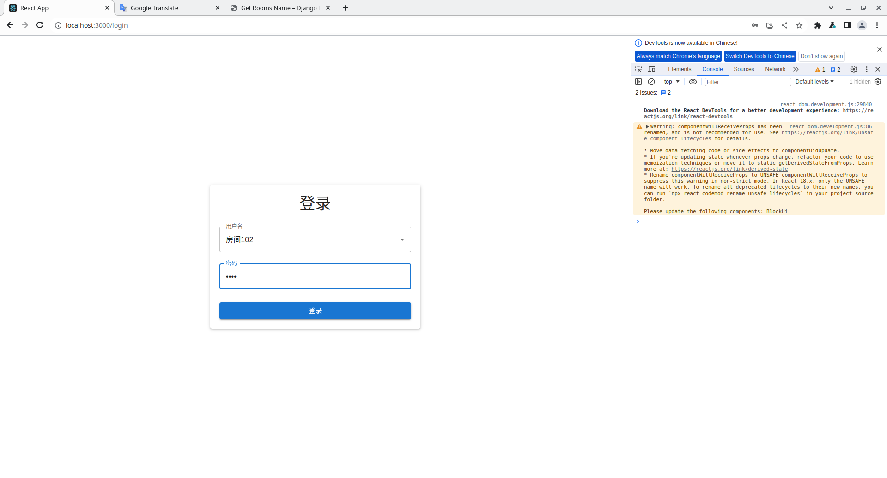
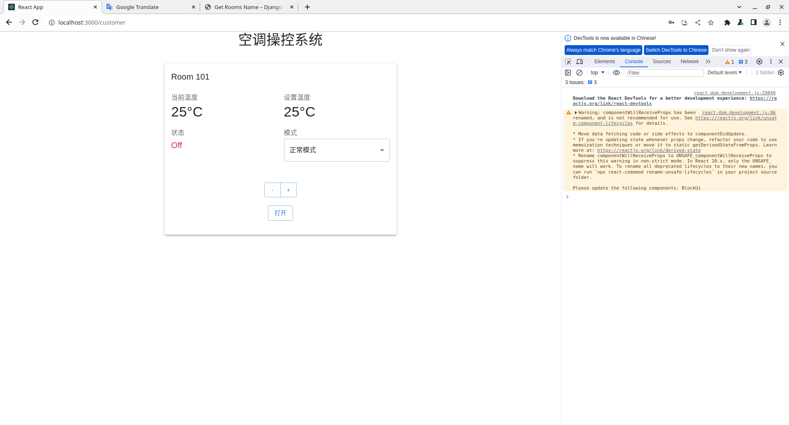
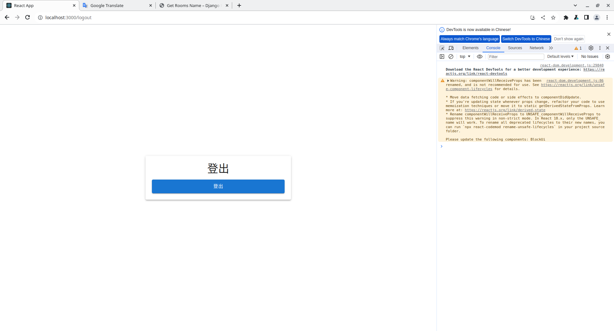

# hotel-air-manager

[中文](#中文) | [English](#english)

---

## 中文

酒店中央空调温控计费系统：房客控制房间空调，前台办理入住/离店结算，管理员监控和配置所有空调。课程项目，前后端分离（Django + React）。

### 状态

早期项目，不再维护。

### 功能

- **房客端**（`/customer`）：开关空调、调节目标温度和风速（低/中/高），实时查看当前温度和费用。
- **前台**（`/reception`）：入住登记、设置房间密码、离店结算、查看和导出详单（CSV）、房间费用图表。
- **空调管理员**（`/ac-manager`）：监控所有房间空调，远程控制，配置全局温度范围和各档风速费率。
- **调度**：Celery 定时任务最多同时服务 3 台空调（运行中 / 等待中），按风速优先级和等待时间调度。
- **温度模拟**：Celery 周期任务模拟室温变化和计费，包括关机后的回温。
- **日志与报表**：操作日志、调度日志、详单记录、房间费用统计。

### 技术栈

- 后端：Python、Django 4.2、Django REST Framework、Celery + django-celery-beat
- 前端：React 18、TypeScript、Redux Toolkit、Material UI（含 x-data-grid / x-charts）、Create React App
- 数据库：SQLite（默认）或 PostgreSQL（`DJANGO_DB=postgresql`）
- 部署：Docker Compose、Nginx、Gunicorn、Let's Encrypt

### 本地运行

后端（端口 8000）：

```bash
cd backend
python3 -m venv venv
source venv/bin/activate
pip install -r requirements.txt
cd backend
# 根目录的 .env 默认 DJANGO_DB=postgresql；本地用 SQLite 需显式指定
export DJANGO_DB=sqlite
python manage.py migrate
python manage.py runserver
```

温度模拟和调度（同一目录、虚拟环境内，各开一个终端；Celery broker 默认是本地 SQLite 文件）：

```bash
celery -A backend worker -l info
celery -A backend beat -l info --scheduler django_celery_beat.schedulers:DatabaseScheduler
```

前端（端口 3000）：

```bash
cd frontend
yarn install
yarn start
```

仓库里提交的 `backend/backend/db.sqlite3` 含演示账号：Django 后台 `/admin` 为 `admin` / `123456`，房客为 `房间101` / `1111`、`房间102` / `2222` 等。也可以用 `python manage.py createsuperuser` 自行创建。

Docker 部署（需要域名，申请 HTTPS 证书，使用 PostgreSQL）：

```bash
chmod +x start-letsencrypt.sh docker/init-letsencrypt.sh
./start-letsencrypt.sh <your domain name>
sudo docker-compose -f docker-compose-pro.yml up --build
```

### 目录结构

```
backend/
  requirements.txt
  backend/          Django 项目（manage.py）
    backend/        settings、urls、celery 配置
    acounts/        用户、登录、房间账号
    conditioners/   空调模型、控制接口、Celery 调度/温度任务
    setup/          全局温度和费率设置
    log/            日志、详单、报表接口
frontend/           React + TypeScript 前端
  src/views/        各角色页面
  src/components/   前台/管理员组件和图表
  src/slices/       Redux slices
docker/             Nginx、后端镜像、Let's Encrypt 脚本
doc/                课程实验文档
docker-compose.yml, docker-compose-pro.yml
README_CHEN.md, README_XU.md   开发期间的分工说明
```

<details>
<summary>截图 / Screenshots</summary>

数据模型图（django-extensions 生成）/ Model diagram:



Django 后台 / Django admin:






</details>

---

## English

Temperature control and billing system for a hotel's central air conditioning: guests control their room AC, reception handles check-in and checkout billing, and the AC manager monitors and configures every unit. A course project with a Django backend and a React frontend.

### Status

Early project, no longer maintained.

### Features

- **Guest** (`/customer`): turn the AC on/off, set target temperature and fan speed (low/medium/high), see current temperature and cost.
- **Reception** (`/reception`): check-in, set room passwords, checkout billing, view and export detail records (CSV), room cost charts.
- **AC manager** (`/ac-manager`): monitor and remotely control all room ACs, configure the global temperature range and per-speed rates.
- **Scheduling**: a Celery task serves at most 3 ACs at once (running / waiting), prioritised by fan speed and waiting time.
- **Temperature simulation**: periodic Celery tasks simulate room temperature and billing, including drift back after the AC is off.
- **Logs and reports**: operation and scheduling logs, detail records, per-room cost statistics.

### Tech stack

- Backend: Python, Django 4.2, Django REST Framework, Celery + django-celery-beat
- Frontend: React 18, TypeScript, Redux Toolkit, Material UI (incl. x-data-grid / x-charts), Create React App
- Database: SQLite (default) or PostgreSQL (`DJANGO_DB=postgresql`)
- Deployment: Docker Compose, Nginx, Gunicorn, Let's Encrypt

### Getting started

Backend (port 8000):

```bash
cd backend
python3 -m venv venv
source venv/bin/activate
pip install -r requirements.txt
cd backend
# the root .env sets DJANGO_DB=postgresql; override it to use SQLite locally
export DJANGO_DB=sqlite
python manage.py migrate
python manage.py runserver
```

Temperature simulation and scheduling (same directory and virtualenv, one terminal each; the Celery broker is a local SQLite file by default):

```bash
celery -A backend worker -l info
celery -A backend beat -l info --scheduler django_celery_beat.schedulers:DatabaseScheduler
```

Frontend (port 3000):

```bash
cd frontend
yarn install
yarn start
```

The committed `backend/backend/db.sqlite3` contains demo accounts: Django admin at `/admin` is `admin` / `123456`; guests are `房间101` / `1111`, `房间102` / `2222`, etc. You can also create your own with `python manage.py createsuperuser`.

Docker deployment (requires a domain for the HTTPS certificate; uses PostgreSQL):

```bash
chmod +x start-letsencrypt.sh docker/init-letsencrypt.sh
./start-letsencrypt.sh <your domain name>
sudo docker-compose -f docker-compose-pro.yml up --build
```

### Directory structure

```
backend/
  requirements.txt
  backend/          Django project (manage.py)
    backend/        settings, urls, Celery config
    acounts/        users, login, room accounts
    conditioners/   AC model, control API, Celery scheduling/temperature tasks
    setup/          global temperature and rate settings
    log/            logs, detail records, report APIs
frontend/           React + TypeScript frontend
  src/views/        pages for each role
  src/components/   reception/manager components and charts
  src/slices/       Redux slices
docker/             Nginx, backend image, Let's Encrypt scripts
doc/                course lab documents
docker-compose.yml, docker-compose-pro.yml
README_CHEN.md, README_XU.md   task notes from development
```

Screenshots: see the collapsible section at the end of the Chinese part above.
